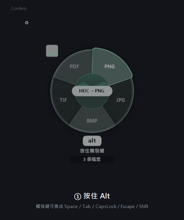
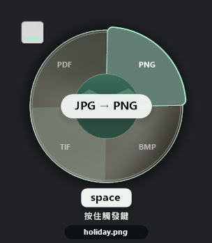
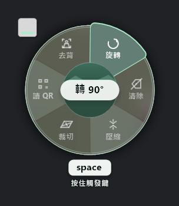
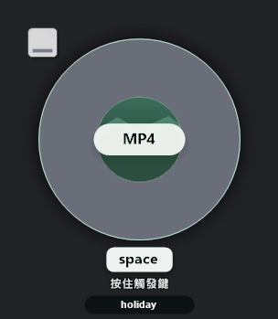
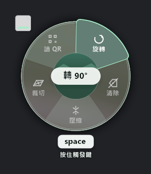
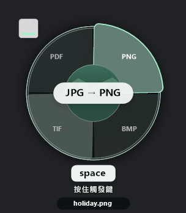
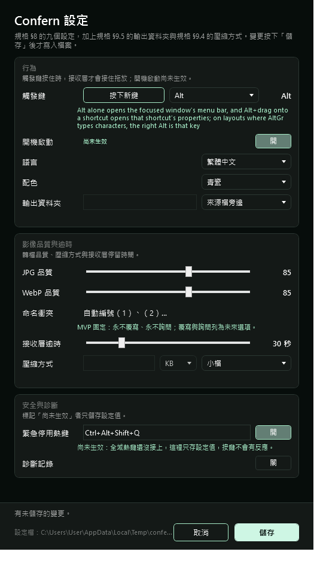
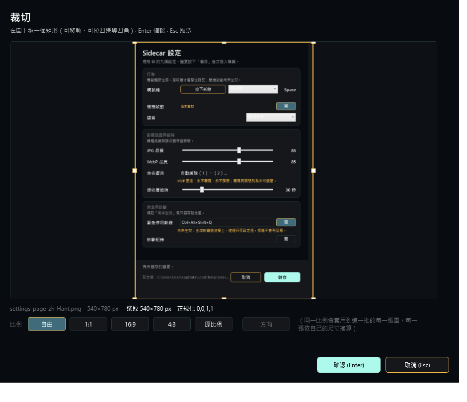

# Confern

**Hold Alt, drag a file, drop it on the format you want.** A Windows 10/11 desktop converter with no main window: a radial menu appears next to your cursor, you pick a target format, it converts.

[**Download**](https://github.com/bboyjokerd-max/confern/releases/latest) · [MIT licence](LICENSE) · [Report a bug](https://github.com/bboyjokerd-max/confern/issues) · **English** | [繁體中文](README.zh-Hant.md)



<sub>↑ Real interaction, recorded 2026-11-03 ([higher quality mp4](docs/demo/confern-demo.mp4)).</sub>

---

## What it is

While you drag a file with the trigger key held down (Alt by default), a wheel appears beside the cursor. Its slices are **the formats that file can become**. Drop on a slice to convert; drop on the centre to do nothing. The result lands next to the original.

No main window. No queue. No interface to learn. It is a drag gesture, not an application.

| | |
|---|---|
| Images | PNG · JPG · BMP · TIF · PDF · WebP (transparency preserved) |
| Video | common formats both ways, audio extraction |
| Documents | images to PDF |
| AI cutout | **CUTOUT**: drop a photo, get a transparent PNG of the subject (paid edition) |

## Two editions, one source

This is not "crippled vs complete". The free edition is simply **one tool short**.

| | Free / open source | Paid |
|---|---|---|
| Wheel conversions | yes | yes |
| Video, PDF, batch | yes | yes |
| **CUTOUT (AI background removal)** | does not exist in this build | 10 free uses included |
| Price | free | licence key, verified offline |

The free edition does not have a locked cutout feature; it has one fewer slice on the wheel.

## Screens

The wheel shows what the dragged file can become. Choose a format and the wheel turns again — **the second layer is what to do with it**.

<table>
<tr>
<td align="center"><br><sub><b>First layer</b>: an image was dragged, so the slices are its target formats</sub></td>
<td align="center"><br><sub><b>Second layer</b>: convert, crop, merge, <b>CUTOUT</b>…</sub></td>
</tr>
<tr>
<td align="center"><br><sub>Drag a video and the slices change with it</sub></td>
<td align="center"><br><sub>Second layer in the <b>free</b> build — no CUTOUT slice</sub></td>
</tr>
</table>

The two second-layer images are genuinely different files (sha256 `42F6A236…` vs `23750A7D…`): that is what "one tool short" looks like.

<table>
<tr>
<td align="center"><br><sub>Same wheel over a dark background</sub></td>
<td align="center"><br><sub>Settings (right-click the tray icon)</sub></td>
</tr>
</table>



<sub>Crop: drag to decide what to keep. Every image above is the product's own offscreen render (`--wheel-demo --wheel-dump`, `--wheel-tools`, `--settings-ui-dump`, `--crop-ui-dump`), not a screenshot of a desktop.</sub>

## Requirements

- Windows 10 or 11, x64
- [.NET 8 Desktop Runtime](https://dotnet.microsoft.com/download/dotnet/8.0) (the installer checks and tells you)

## Install

1. Get the installer from [Releases](https://github.com/bboyjokerd-max/confern/releases/latest)
2. Run it — **no administrator rights needed** (it installs per user)
3. Start dragging files

Uninstalling asks whether to remove your settings and licence too (kept by default).

## Using it

| Action | How |
|---|---|
| Show the wheel | hold **Alt** and drag a file |
| Pick a format | drop on that slice |
| Cancel | drop on the centre disc, or press `Esc` |
| Watch a folder | point the setting at it and forget about it |
| Batch | drag several files at once |
| Settings | right-click the tray icon |

Converted files are written **next to the original** with the same name and a new extension. The original is never modified.

## Command line

The product is its own diagnostic tool (it is a GUI process, so evidence goes to stderr and the log file):

```
Confern.exe formats                     list the formats this machine supports
Confern.exe convert in.png -o out.jpg   convert one file
Confern.exe check-updates               ask once whether a newer build exists
Confern.exe license                     licence state and remaining uses
Confern.exe --help                      every flag
```

## Build from source

```
dotnet build src\Sidecar\Sidecar.csproj -c Release                 # paid edition
dotnet build src\Sidecar\Sidecar.csproj -c Release -p:Edition=Free # free edition
```

Requires the .NET 8 SDK. Installers: `powershell -File tools\build-installer.ps1` (Inno Setup).

## Status

Early but usable (`0.1.0`). Verification is 20 automated suites and 687 checks running against real windows and real files — including things you only learn by actually dragging, like "the payload is only reachable mid-drag".

`docs/` holds the design spec, a daily progress log, and a falsifiability audit (which assertions could never fail).

## Licence

[MIT](LICENSE). Use it, modify it, redistribute it, sell it.

**Plainly**: MIT means anyone can build a cutout with no 10-use limit. The paid edition is an honour system — we would rather write that here than pretend a lock exists.
