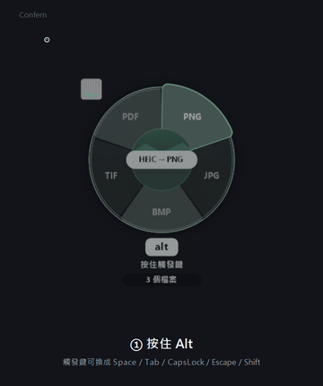
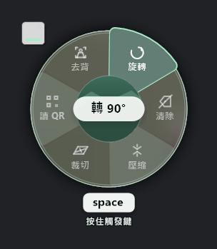
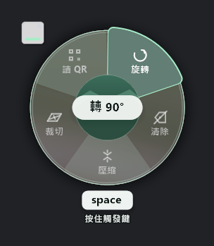
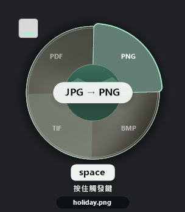
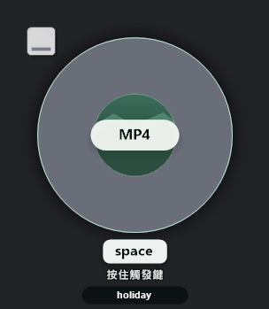
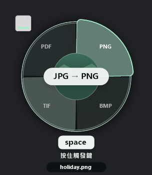
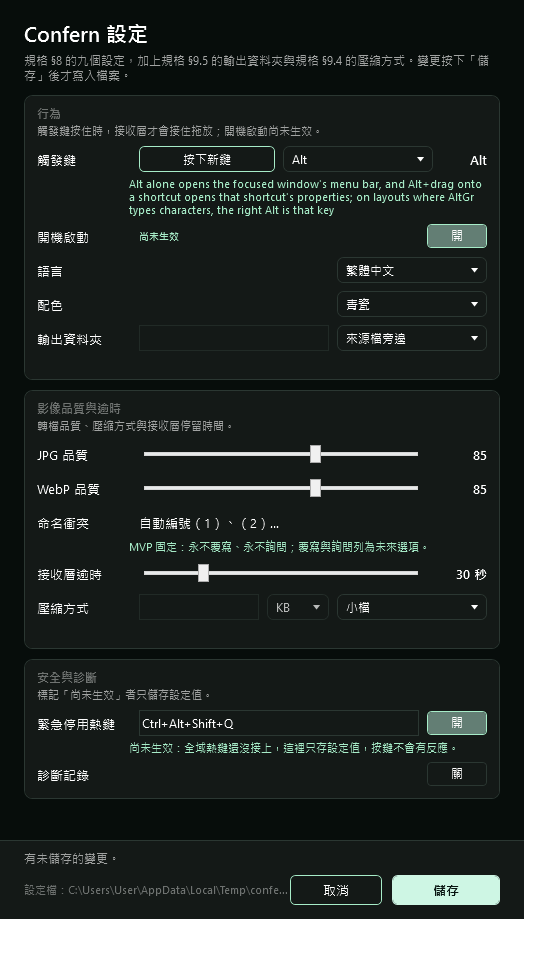
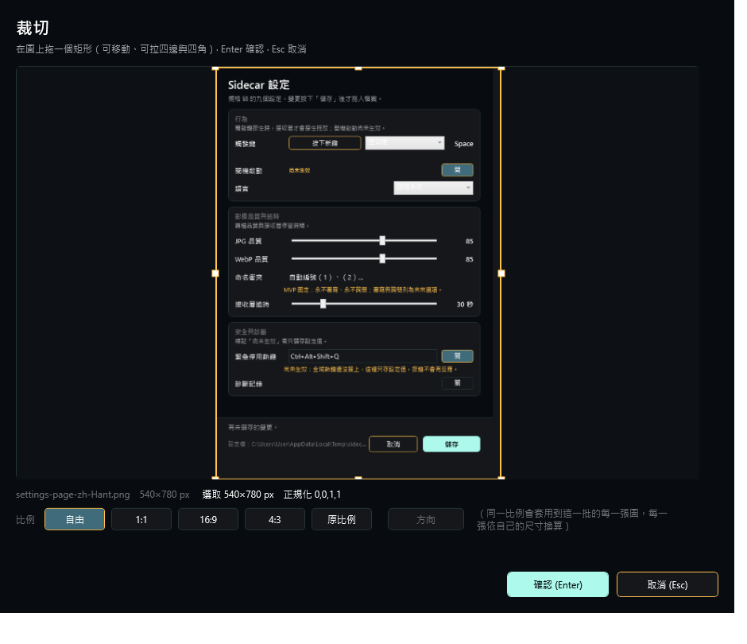

# Confern

[English](README.md) | **繁體中文**

**把檔案拖到輪盤上，就開始轉檔。** Windows 10/11 x64 的桌面轉檔工具：拖進來、轉一下、選格式，不用開任何視窗。

[**下載最新版**](https://github.com/bboyjokerd-max/confern/releases/latest) · [授權 MIT](LICENSE) · [回報問題](https://github.com/bboyjokerd-max/confern/issues)



<sub>↑ 實際操作畫面（[高畫質 mp4](docs/demo/confern-demo.mp4)）　錄製於 2026-11-03，內容就是這個版本的行為。</sub>

---

## 畫面

拖什麼檔案，輪盤就長什麼樣子。選定格式之後，輪盤再轉一層——**第二層是「要做什麼」**：

<table>
<tr>
<td align="center"><br><sub><b>第二層（付費版）</b>：轉檔、裁切、合併、<b>CUTOUT 去背</b>…</sub></td>
<td align="center"><br><sub><b>第二層（免費版）</b>：同一支程式，沒有 CUTOUT 那一顆</sub></td>
</tr>
</table>

上面兩張是**真的不一樣**（sha256 不同：`42F6A236…` vs `23750A7D…`）——這就是「免費版少一顆工具」的實際樣子。

<table>
<tr>
<td align="center"><br><sub><b>第一層</b>：拖的是圖片，扇形是它<b>能變成</b>的格式</sub></td>
<td align="center"><br><sub>拖的是影片，扇形跟著換一批</sub></td>
</tr>
<tr>
<td align="center"><br><sub>深色桌布下的同一顆輪盤</sub></td>
<td align="center"><br><sub>設定頁（右鍵托盤圖示）</sub></td>
</tr>
</table>



<sub>裁切視窗：決定要留下哪一塊</sub>


<sub>以上都是產品自己的離屏渲染（`--wheel-demo --wheel-dump`、`--settings-ui-dump`、`--crop-ui-dump`），不是螢幕截圖。</sub>

## 這是什麼

按住觸發鍵（預設 Alt）拖著檔案移動時，一個圓形輪盤會出現在游標旁邊，上面是**這個檔案可以轉成的格式**。
拖到要的扇形上放開，就開始轉；拖到中心，什麼都不做。轉好的檔案出現在原檔旁邊。

沒有主視窗、沒有佇列、沒有要學的介面。它是一個拖曳手勢，不是一個應用程式。

| | |
|---|---|
| 影像 | PNG · JPG · BMP · TIF · PDF · WebP（含透明背景） |
| 影片 | 常見格式互轉、抽音訊 |
| 文件 | 影像轉 PDF |
| AI 去背 | **CUTOUT**：拖進來，拿走只剩主角的透明 PNG（付費版） |

## 兩個版本，同一份原始碼

這不是「閹割版 vs 完整版」的行銷話術，是**少一顆工具**。

| | 免費開源版 | 付費版 |
|---|---|---|
| 拖曳輪盤轉檔 | ✓ | ✓ |
| 影片、PDF、批次 | ✓ | ✓ |
| **CUTOUT（AI 去背）** | — 沒有這顆工具 | ✓ 附 10 次免費額度 |
| 價格 | 免費 | 授權金鑰，離線驗證 |

免費版**沒有**去背功能，不是鎖住。少一顆扇形，其餘完全一樣。

## 系統需求

- Windows 10 或 11，x64
- [.NET 8 桌面執行階段](https://dotnet.microsoft.com/download/dotnet/8.0)（安裝程式會檢查，沒有會提示）

## 安裝

1. 到 [Releases](https://github.com/bboyjokerd-max/confern/releases/latest) 下載安裝檔
2. 執行，**不需要管理員權限**（裝在使用者資料夾）
3. 開始拖檔案

解除安裝時會問你：要不要一起刪掉設定與授權（預設保留）。

## 使用

| 動作 | 怎麼做 |
|---|---|
| 叫出輪盤 | 按住 **Alt**，拖著檔案移動 |
| 選格式 | 拖到對應的扇形上放開 |
| 取消 | 拖到圓盤中心放開，或按 `Esc` |
| 監看資料夾 | 設定某個資料夾，丟進去的檔案自動轉 |
| 批次 | 一次拖多個檔案進來 |
| 設定 | 右鍵托盤圖示 |

轉好的檔案放在**原檔旁邊**，檔名相同、副檔名不同。原檔不會被動到。

## 命令列

產品自己就是一支可診斷的命令列工具（GUI 沒有主控台，證據寫在日誌與 stderr）：

```
Confern.exe formats                     列出這台機器支援的格式
Confern.exe convert in.png -o out.jpg   轉一個檔案
Confern.exe check-updates               問一次有沒有新版本
Confern.exe license                     授權狀態
Confern.exe --help                      全部旗標
```

## 從原始碼建置

```
dotnet build src\Sidecar\Sidecar.csproj -c Release                 # 付費版
dotnet build src\Sidecar\Sidecar.csproj -c Release -p:Edition=Free # 免費版
```

需要 .NET 8 SDK。安裝檔用 Inno Setup：`powershell -File tools\build-installer.ps1`。

## 專案狀態

早期但可用（`0.1.0`）。驗收是 20 套自動化套件、687 個檢查，跑在真實的視窗與檔案上——
包括「拖曳途中才拿得到酬載」這種只有實際拖過才知道的事。

`docs/` 裡有完整的設計規格、逐日進度與一次「假故障稽核」（哪些斷言其實永遠不會紅）。

## 授權

[MIT](LICENSE)。你可以自由使用、修改、再散布，包含商業用途。

**誠實說明**：授權是 MIT，所以任何人都能自己編一個沒有 10 次限制的去背版。
付費版是信任制——我們選擇這樣，因為擋不住的事寫在文件裡比寫在程式裡誠實。

---

<sub>English: Confern is a drag-and-drop file converter for Windows. Hold Alt, drag a file, and a
radial menu appears with the formats that file can become; drop on a slice to convert. No main
window. The paid edition adds CUTOUT (AI background removal); the free, open-source edition simply
does not have that one tool. MIT licensed.</sub>
